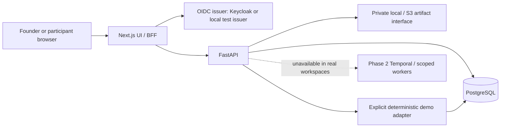

# Phase 1 architecture

The browser holds an HttpOnly encrypted session cookie. Provider/service credentials
and access tokens stay in server routes. Mutations pass an origin check at the BFF.
OIDC identity resolves a membership and role; verified membership sets transaction-local
tenant context. PostgreSQL RLS and composite tenant/parent foreign keys protect
application relationships. The application role is not an owner or superuser.

The invitation token is a separate expiring, revocable capability. Only its SHA-256
hash is stored. An assignment RLS policy permits the exact token hash or an authorized
tenant operator. Participants receive a minimal neutral task DTO. Consent precedes
submission, submitted feedback is immutable, and moderation creates a report version.
Contact information, recordings, payouts, participant marketplaces and automatic
recruitment are not implemented.

## Schema boundaries

Identity: users, tenants, memberships, audit_events, workspace_settings.
Product: projects, product_builds, messages (including intake draft), brief_versions.
Planning: persona_versions, test_plans, plan_personas, tasks.
Theatre: runs, journey_sessions, steps, artifacts, run_events, outbox_events,
evidence_annotations. Results: findings, finding_reviews, report_versions, retest_links.
Human: human_studies, study_assignments (consent/submission/review snapshots).
Economics: budget_reservations, usage_ledger, idempotency_records.
Research: research_sources for owned illustrative case notes.

Phase 1 consolidates human application/screening into assignment and audit records,
and flexible sample case notes into research_sources. Expand the research case/claim/source
joins, participant profiles/applications, consent history and incentive ledger through
Alembic when real Phase 2 providers/operations require them. There is no second schema
owner, Prisma, browser-local project store or separate fake API.

## Demo progression, evidence and streaming

An approved plan creates immutable run/persona/task snapshots, 24 default journeys,
an outbox record and a single budget reservation. Tenant-scoped idempotency keys are
serialized with a PostgreSQL advisory lock. Different payloads under one key conflict.
Runs advance only through the explicit demo adapter. Progress is derived from persisted
creation time and deterministic batch offsets; reconnect does not create a new run.
This is fixture playback, not durable browser orchestration.
Custom assertions are not silently executed by the fixture adapter; they remain
UNKNOWN/POLICY. Comparisons require matching task/persona snapshots as well as milestones.

Steps and ordered events are committed before stream delivery. SSE has stable sequence
IDs, cursors, heartbeats and capped pages. The client deduplicates IDs and reconciles
authoritative snapshots, with bounded polling fallback. Synchronous database work is
offloaded from the ASGI event loop; lock/statement timeouts bound service waits.

Demo evidence is captured through actual Playwright interactions with the owned fixture,
then replayed with provenance labels. New artifact objects use content hashes so later
fixture recaptures do not rewrite an existing run's bytes. The stage never claims video,
invented click coordinates or model thoughts. Pause replay controls viewing only; cancel
is separate and preserves partial evidence. Findings keep run/session/step IDs in URLs.

Demo settlement is exactly once with zero real provider usage. The reservation is a
configured scope limit, not money charged. Real launch returns 503 and creates no run,
ledger entry or fake success. Retests preserve a baseline and match semantic milestones,
persona/task/viewport coverage. Missing coverage and heuristic disclosure concerns stay
untested. Human review is independent of fixture-fix status.

## Deliberate Phase 2 boundary

No automatic outbox dispatch, Temporal workflow, LangGraph agent loop, Browser Use
executor, live research retrieval, axe/Lighthouse run engine or recorder exists here.
The workspace's own accessibility QA is separate from a customer-product audit engine.
Network isolation, SSRF/rebinding controls, target verification, real quotas, redaction,
worker restart/recovery and remote artifact publication must pass before enabling real
execution. No engine is activated simply by setting credentials.
